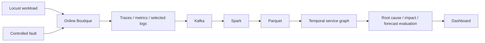

# Cloud Chaos Twin

An experimental platform for studying how faults spread through microservice systems.

**Group 1 · AMS 560.01 / CSE 542.01 · Fall 2026**

## Start here

1. Read the [team task board](docs/TEAM_TASKS.md) and find your first deliverable.
2. Follow [setup and onboarding](docs/SETUP.md).
3. Run the small offline demo below. It needs Python 3.9+ and no external packages.
4. Read the [ten-week execution plan](docs/PROJECT_PLAN.md).

```sh
git clone https://github.com/maitreya-v/cloud-chaos-twin.git
cd cloud-chaos-twin
python3 -m cct doctor
python3 -m cct check
python3 -m cct demo
python3 -m unittest discover -s tests -v
```

On Windows, use `py -3` instead of `python3`, or use WSL for later container work.

Open `outputs/demo/report.html` in a browser after running the demo. It also writes `graph.json` and `service_summary.csv` to that directory. The report works offline.

## Current status

| Available now | Still to implement and validate |
| --- | --- |
| Shared plan, ownership, onboarding, and task templates | Live Online Boutique deployment |
| Python environment checker | OpenTelemetry, Jaeger, Prometheus, and log collection |
| Synthetic span fixture and normalized-span schema | Kafka ingestion and Spark/Parquet processing |
| Offline dependency graph and phase summary | Real fault injection and experiment automation |
| Automated checks and HTML demo report | Root-cause ranking and prospective cascade prediction |
| Kubernetes, collector, and scoped fault templates | Hardware calibration and reproducible live benchmarks |

**The demo uses invented data. It demonstrates file formats and graph plumbing; it is not a real fault experiment, performance result, or prediction model.** Infrastructure templates have not been deployed by this starter setup. Team hardware must be checked before choosing the live configuration.

## Intended architecture



An arrow in the dependency graph means **caller -> callee**. Failure impact may travel in the reverse direction. Observed reconstruction and predictions made before future impact are evaluated separately.

## Team

| Member | Main ownership |
| --- | --- |
| Maitreya Vaghulade | Testbed, workload, architecture, integration |
| Merul Shah | Traces, metrics, selected logs, telemetry quality |
| Param Shah | Kafka, Spark, Parquet, processing benchmarks |
| Komalika Acharya | Fault library, experiment runner, ground-truth records |
| Mithil Bavishi | Graph methods, cascade analysis, evaluation |

Maitreya supports dashboard integration; Merul reviews health labels; Param prepares evaluation tables.

## Repository map

| Location | Contents |
| --- | --- |
| `cct/`, `tests/` | Runnable offline starter and checks |
| `data/samples/`, `schemas/` | Small synthetic fixture and data contracts |
| `infra/`, `observability/`, `chaos/` | Initial configuration templates |
| `configs/` | Example experiment and version record |
| `workload/`, `ingestion/`, `processing/` | Component handoff notes |
| `analytics/`, `dashboard/` | Analytics and UI implementation boundaries |
| `docs/` | Setup, task board, architecture, sharing, full plan |
| `outputs/` | Generated local results, excluded from Git |

See [CONTRIBUTING.md](CONTRIBUTING.md) for the branch/review workflow and [data/README.md](data/README.md) for storage rules. [Sharing instructions](docs/SHARING.md) explain read access and collaborator access. The original proposal PDF and student IDs are not part of this repository.
