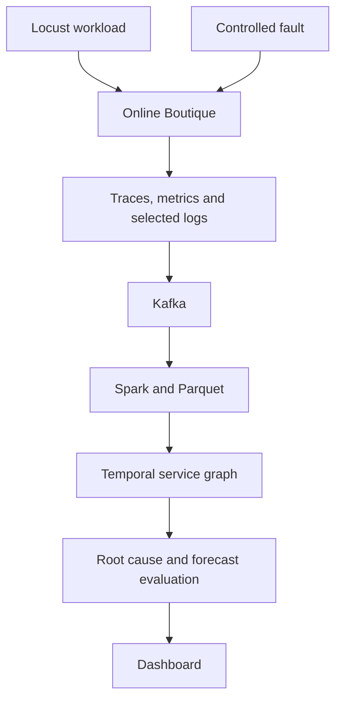

# Cloud Chaos Twin

**Group 1 · AMS 560.01 / CSE 542.01 · Fall 2026**

Cloud Chaos Twin studies how failures spread through Online Boutique, a microservice shopping application. The project has two objectives. The first is to reconstruct which services handled a request and became unhealthy during a recorded fault. The second is to test whether signals available at a given time can predict which services will be affected next.

## Implementation and evidence

| Component | What the team has verified | Remaining work |
| --- | --- | --- |
| Testbed and workload | Maitreya deployed Online Boutique on an ARM64 kind cluster and verified browsing, cart updates, and checkout. The [matched tracing pair](docs/CCT-04_PAIRED_OVERHEAD.md) passed both 15-minute measurements with zero failed requests. | Broader host/workload replication; the single pair is descriptive. |
| Traces, metrics, and logs | The [live rollout](docs/CCT-03_TRACING_ROLLOUT.md) recovered all 15 required journey relationships. Merul independently verified the journeys and service data. The owner's new [coverage campaign](docs/CCT-10_STATUS.md) reconciled 70,200 healthy calls against an untraced request ledger and independent counters. | Teammate acceptance of new artifacts; coverage outside the measured scope. |
| Dependency graph and baseline metrics | Mithil reproduced the graph and all 15 required journey relationships. [CCT-09 acceptance](docs/evidence/CCT-09-mithil-real.json). New healthy capture supplies 59 qualifying calibration windows for each of ten services. | Reserved-run evaluation and broader replication. |
| Health labels and forecasting | Merul's candidate health rule is integrated with Mithil's training-only calibration, graph/root/cascade baselines and separate outcome evaluator. Synthetic checks pass. | Joint review, real calibration and independently labeled fault runs. Forecast accuracy remains unmeasured. |
| Processing and experiments | Param recorded successful Kafka/Spark/Parquet replay on synthetic and healthy data. The owner subsequently verified a [controlled fault replay](docs/CCT-10_PIPELINE_REPLAY.md), restart and full rebuild. Mithil's analytics produced its retrospective graph. | Teammate artifact acceptance, independent coverage/impact review and calibrated evaluation. |

The [deployment record](docs/CCT-02_LOCAL_DEPLOYMENT.md) documents the baseline and its timing precision. The [task board](docs/TEAM_TASKS.md) defines the acceptance criteria for each deliverable.

The [first controlled fault pilot](docs/CCT-10_STATUS.md#first-controlled-live-pilot)
recorded a 30-second productcatalog delay and automatic recovery with 447
successful workload operations, archived traces, metrics, logs and fresh pod
observations. Health calibration still needs independent coverage review and
sufficient per-service volume; this pilot does not establish forecast accuracy.

## Repository and frozen version

The public repository is [maitreya-v/cloud-chaos-twin](https://github.com/maitreya-v/cloud-chaos-twin). The tag `merul-telemetry-2026-11-24` identifies the tested telemetry implementation at commit `cfab3d0ce1af576aaa3bbba72276322c8c361c66`. The tag reproduces the November 24 offline milestone. The [November 25 integrated revision](https://github.com/maitreya-v/cloud-chaos-twin/tree/e764ca675bb8a5ce3e75bb3e7fe9e00345028adf) adds the live tracing fixes, rollout tool and independent verifier. The slides and report linked here describe the November 24 milestone. [Merged telemetry PR](https://github.com/maitreya-v/cloud-chaos-twin/pull/4) · [Presentation slides](docs/submission/Cloud-Chaos-Twin-Slides.pdf) · [Project report](docs/submission/Cloud-Chaos-Twin-Report.pdf)

## Installation and reproduction

For the current code, clone the repository and stay on `main`. The live verifier runs with `python3 -m observability.record` after cluster setup in the [telemetry runbook](observability/README.md). To reproduce the frozen offline milestone, use the checkout below. The offline workflow requires Git and Python 3.9 or newer. It uses the Python standard library. Run the commands from a shell, using WSL or the `py -3` launcher for Python on Windows.

```sh
git clone https://github.com/maitreya-v/cloud-chaos-twin.git Cloud-Chaos-Twin
cd Cloud-Chaos-Twin
git switch --detach merul-telemetry-2026-11-24
git rev-parse HEAD
python3 -m cct doctor
python3 -m cct check
python3 -m unittest discover -s tests -v
python3 -m cct demo
python3 -m observability.fixture
python3 -m observability.export_sample outputs/sample-otlp
python3 observability/stack.py > outputs/stack.review.json
```

For reproduction from an existing Git bundle, replace the clone command with `git clone -b feature/merul-telemetry Cloud-Chaos-Twin.bundle Cloud-Chaos-Twin`.

| Verification | Expected output at the frozen revision |
| --- | --- |
| Revision and tests | The commit matches the SHA above and all 25 unit tests pass. |
| Offline demo | Nine synthetic spans produce `report.html`, `graph.json`, and `service_summary.csv` in `outputs/demo/`. Open the HTML file in a browser. |
| Journey reconstruction | Walking through client spans to the nearest server ancestor recovers 4 browse, 2 cart, and 9 checkout relationships. Direct server-parent matching recovers 0 of 15 because the fixtures place a client span between services. |
| Telemetry samples and manifests | `outputs/sample-otlp/` contains synthetic OTLP records for the processing pipeline. `outputs/stack.review.json` contains the rendered Kubernetes resources for review. |

## Architecture and execution path

The monitoring stack accepts application spans over OTLP. The Collector sends full traces to Jaeger and derives request counts and duration histograms from server spans for Prometheus. During a shopping test, the probe retrieves the trace for each request by ID and checks its caller–callee relationships. A separate reader captures selected application logs, pod readiness, and restart counts for the workload evidence. The [telemetry runbook](observability/README.md) covers scoped deployment, native image builds, verification, and rollback. The [signal contract](observability/CONTRACT.md) defines identities, timestamps, units, and missing-data rules.

The diagram shows the planned end-to-end experiment. Kafka export is optional in the monitoring configuration. The processing stage has passed local synthetic and recorded healthy-data replay. Fault-run integration and prediction evaluation remain pending.



A dependency edge points from the calling service to the service it calls. A failure in a downstream service can affect its callers. Reconstruction uses observations from the recorded run. Forecast evaluation uses only information available by the prediction cutoff.

## Ownership and source guide

| Team member | Responsibility |
| --- | --- |
| Maitreya Vaghulade | Testbed deployment, workload, architecture, dashboard integration, and shared experiments |
| Merul Shah | Trace propagation, service metrics, selected logs, telemetry quality, and health-label review |
| Param Shah | Kafka ingestion, Spark processing, Parquet storage, processing benchmarks, and evaluation tables |
| Komalika Acharya | Fault experiments, experiment runner, recovery checks, and ground-truth records |
| Mithil Bavishi | Dependency graphs, health-label design, cascade analysis, and forecast evaluation |

| Location | Purpose |
| --- | --- |
| `cct/`, `tests/` | Offline analysis, demo generation, and automated checks |
| `scripts/`, `infra/`, `workload/` | Testbed setup, shopping checks, and baseline workload |
| `observability/` | Monitoring configuration, application tracing patches, journey verification, and candidate health rule |
| `data/samples/`, `schemas/`, `configs/` | Synthetic inputs, data contracts, and experiment configuration |
| `ingestion/`, `processing/`, `chaos/`, `analytics/`, `dashboard/` | Component plans, interfaces, and experiment templates |
| `docs/`, `outputs/` | Versioned evidence and submission files in `docs/`. Generated local results in `outputs/`. |

See the [setup guide](docs/SETUP.md), [cluster access guide](docs/PRIVATE_ACCESS.md), and [project plan](docs/PROJECT_PLAN.md) for deployment requirements and milestones. The [contribution guide](CONTRIBUTING.md), [data guide](data/README.md), and [sharing guide](docs/SHARING.md) cover review, storage, and repository access.

### Kafka / Spark / Parquet replay (Param)

The staged pipeline implementation, local setup and acceptance commands are in [ingestion/README.md](ingestion/README.md); table contracts and cutoff semantics are in [processing/README.md](processing/README.md). See [CCT-05/06 status](docs/CCT-05-06_PIPELINE.md) for measured local acceptance and scalability results, limitations and remaining fault-run integration gates. The offline starter demo does not start Kafka or Spark.

### Dependency graphs and forecast evaluation (Mithil)

Run `python3 -m analytics demo` and open `outputs/analytics-demo/report.html` for a synthetic graph, health timeline, root rankings and cascade comparisons. The [analytics runbook](analytics/README.md) covers real receipt/Parquet input, calibration, prediction and evaluation. [Mithil's handoff](docs/CCT-09-10_ANALYTICS.md) records completed CCT-09 real-data acceptance and pending CCT-10 calibration/evaluation. The reproduced real graph and service summaries are under `outputs/analytics-real/`. The synthetic example establishes no measured forecasting accuracy.
