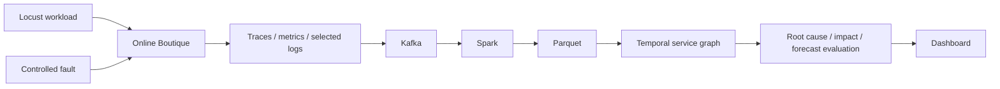

# Cloud Chaos Twin

An experimental platform for studying how faults spread through microservice systems.

**Group 1 · AMS 560.01 / CSE 542.01 · Fall 2026**

## Frozen telemetry version and reproduction

The public project hosts [Merul’s frozen telemetry implementation](https://github.com/maitreya-v/cloud-chaos-twin/tree/cfab3d0ce1af576aaa3bbba72276322c8c361c66). The tag `merul-telemetry-2026-11-24` identifies the tested implementation on the `feature/merul-telemetry` branch. Its parent, `df96c8c821fbc10dcbaad0ef518eb2b74334f664`, contains the CCT-02 and private-access merges on the deployment branch. The [three presentation slides](docs/submission/Cloud-Chaos-Twin-Slides.pdf) and [seven-page project report](docs/submission/Cloud-Chaos-Twin-Report.pdf) record the November 24 evidence.

Clone with `git clone https://github.com/maitreya-v/cloud-chaos-twin.git Cloud-Chaos-Twin`, or use `git clone -b feature/merul-telemetry Cloud-Chaos-Twin.bundle Cloud-Chaos-Twin` for an offline checkout. Then run the following commands.

```sh
cd Cloud-Chaos-Twin
git switch --detach merul-telemetry-2026-11-24
git rev-parse HEAD
python3 -m cct check
python3 -m unittest discover -s tests -v
python3 -m cct demo
python3 -m observability.fixture
python3 -m observability.export_sample outputs/sample-otlp
python3 observability/stack.py > outputs/stack.review.json
```

The offline commands require Python 3.9+ and the standard library. The first demo uses nine normalized synthetic spans. The separate RPC fixture constructs three Jaeger-format traces and checks the caller graph. Expect four browse, two cart and nine checkout edges from the ancestor walk, with zero direct SERVER-parent matches. The upstream deployment evidence is in [the CCT-02 record](docs/evidence/CCT-02-maitreya.json).

**Live execution path.** Boutique sends OTLP spans to the Collector. The full trace goes to Jaeger. A separate pipeline filters SERVER spans to generate calls and duration histograms for Prometheus. A Kubernetes Job sends isolated shopping requests and queries the same trace IDs back from Jaeger. Merul's log reader captures allowlisted events and pod readiness/restarts, then optionally relays OTLP batches. The Kafka exporter is opt-in. The [runbook](observability/README.md) specifies commands, image versions, ownership boundaries, acceptance, partial failures and rollback. The [schema and timing contract](observability/CONTRACT.md) defines deduplication and cutoff-aware labels. Deployment requires the approved Kubernetes connection, plus the owner's Docker/buildx and kind host for native images. The rendering and fixture checks can run offline. See the team table below for downstream ownership.

## Start here

1. Read the [team task board](docs/TEAM_TASKS.md) and find your first deliverable.
2. Follow [setup and onboarding](docs/SETUP.md).
3. Run the small offline demo below. It needs Python 3.9+ and no external packages.
4. Read the [ten-week execution plan](docs/PROJECT_PLAN.md).

```sh
git clone https://github.com/maitreya-v/cloud-chaos-twin.git
cd cloud-chaos-twin
python3 -m cct doctor
python3 -m cct check
python3 -m cct demo
python3 -m unittest discover -s tests -v
```

On Windows, use `py -3` instead of `python3`, or use WSL for later container work.

Open `outputs/demo/report.html` in a browser after running the demo. It also writes `graph.json` and `service_summary.csv` to that directory. The report works offline.

## Current status

| Available now | Still to implement and validate |
| --- | --- |
| Shared plan, ownership, onboarding, and task templates | Each teammate completing repository onboarding |
| Private Boutique HTTPS and individual Kubernetes permissions | Invitation acceptance and a teammate test from another Internet connection |
| Native ARM64 Online Boutique, shopping checks, and low-load baseline | Calibrated workload levels with the full collection stack |
| Collector, Jaeger, Prometheus and log pilot implementation | Live traces for all three journeys, timestamped log/metric evidence and matched overhead runs |
| Synthetic span fixture and normalized-span schema | Kafka ingestion and Spark/Parquet processing |
| Offline dependency graph and phase summary | Real fault injection and experiment automation |
| Automated checks and HTML demo report | Root-cause ranking and prospective cascade prediction |
| Kubernetes, collector, and scoped fault templates | Hardware calibration and reproducible live benchmarks |

**The offline demo uses invented data. It demonstrates file formats and graph plumbing; it is not a real fault experiment, performance result, or prediction model.** Separately, Online Boutique is deployed on Maitreya's selected Mac and completed a nominal 15-minute, five-user baseline with 1,000 successful requests; see the [local deployment record](docs/CCT-02_LOCAL_DEPLOYMENT.md) for measurements and timer precision. Observability, faults, and the combined processing stack still need deployment and validation.

The [private-access guide](docs/PRIVATE_ACCESS.md) records the working website, authenticated Kubernetes endpoint, applied teammate permissions, and connection steps. Merul reported opening the private website on November 24. Individual Kubernetes sign-in and cross-network status for the remaining teammates need verification.

## Intended architecture



An arrow in the dependency graph means **caller -> callee**. Failure impact may travel in the reverse direction. Observed reconstruction and predictions made before future impact are evaluated separately.

## Team

| Member | Main ownership |
| --- | --- |
| Maitreya Vaghulade | Testbed, workload, architecture, integration |
| Merul Shah | Traces, metrics, selected logs, telemetry quality |
| Param Shah | Kafka, Spark, Parquet, processing benchmarks |
| Komalika Acharya | Fault library, experiment runner, ground-truth records |
| Mithil Bavishi | Graph methods, cascade analysis, evaluation |

Maitreya supports dashboard integration; Merul reviews health labels; Param prepares evaluation tables.

## Repository map

| Location | Contents |
| --- | --- |
| `cct/`, `tests/` | Runnable offline starter and acceptance checks |
| `scripts/`, `workload/baseline_locust.py` | Native Boutique preparation, shopping checks, and measured baseline |
| `data/samples/`, `schemas/` | Small synthetic fixture and data contracts |
| `infra/`, `observability/`, `chaos/` | Host configuration, runnable telemetry pilot and proposed fault template |
| `configs/` | Example experiment and version record |
| `workload/`, `ingestion/`, `processing/` | Component handoff notes |
| `analytics/`, `dashboard/` | Analytics and UI implementation boundaries |
| `docs/` | Setup, task board, architecture, sharing, full plan |
| `outputs/` | Generated local results, excluded from Git |

See [CONTRIBUTING.md](CONTRIBUTING.md) for the branch/review workflow and [data/README.md](data/README.md) for storage rules. [Sharing instructions](docs/SHARING.md) explain read access and collaborator access. The original proposal PDF and student IDs are not part of this repository.
