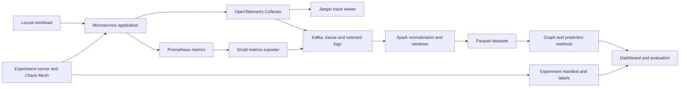

# Cloud Chaos Twin: detailed startup and execution plan

Prepared for Group 1, based on the supplied proposal and the confirmed ten-week deadline. No university server, cloud credits, or hardware budget is currently confirmed. Laptop specifications still need to be inventoried. Resource sizes and time allocations below are planning estimates, not measured requirements or vendor guarantees. This document is a plan; infrastructure has not been installed or provisioned.

## 1. The outcome to build toward

Build an experimental platform that runs an existing microservice application, introduces a recorded fault, collects traces/metrics/selected logs, processes telemetry with Kafka and Spark, and shows which services became unhealthy. Then evaluate whether early observations can identify the injected origin and forecast additional impact.

The first demonstration should show one complete experiment: healthy application -> controlled fault -> measurable symptoms -> recorded recovery -> saved dataset -> graph/timeline. Aim for an initial trace-based version by the end of week 2 and a Kafka/Spark version by the end of week 3. The broader MVP remains due in week 5, as proposed.

Keep three results distinct: root-cause ranking, reconstruction of observed impact, and prediction of future impact. A graph drawn after a run is reconstruction. Forecasting requires saving a prediction before the future impact occurs.

Treat the “twin” as an empirical, telemetry-driven model of the testbed. A calibrated simulator that answers arbitrary counterfactual questions is beyond the initial scope.

## 2. Choose one application and keep it fixed

Recommended starting testbed: Google's Online Boutique. It contains ten application services plus a load generator, and uses Redis for carts. Count the load generator as infrastructure; include Redis as an explicit dependency node when instrumented. This fits the proposal's approximate 8-12-service scope without requiring your team to write its own application. It supports Kubernetes, including local deployments. [Official repository](https://github.com/GoogleCloudPlatform/microservices-demo) and [local development guide](https://github.com/GoogleCloudPlatform/microservices-demo/blob/main/docs/development-guide.md).

Deploy the supported application as a whole initially. Removing arbitrary services can break the workload and produce misleading “faults.” Select three fault targets within that application after mapping actual request paths. Candidate targets are productcatalogservice, cartservice, and checkoutservice; verify their workloads and injection compatibility during the pilot. Keep Redis faults as a separate dependency experiment.

Use the supplied Locust workload as the starting point. Exercise browsing, cart updates, and checkout, so faults in those paths are observable. Record the traffic mix, users, think time, offered traffic, and achieved requests per second. A fixed number of virtual users does not guarantee a fixed arrival rate when responses slow down.

Pin the application commit, Kubernetes version, container images, Helm chart versions, Python environment, Spark version, and Kafka connector. Avoid unpinned “latest” images in experiments. Freeze a working version set at the end of week 2; change it only for a documented blocker.

## 3. Hardware and access setup

Do a 30-minute inventory before choosing an installation recipe. Record each teammate's operating system, CPU architecture, RAM, free disk, administrative access, and ability to run containers. Do not assume an Apple Silicon image and an x86 image behave identically; test the selected images on the actual experiment host.

| Available resource | Recommended use |
| --- | --- |
| Laptop with about 8 GB RAM | Editing, dashboard development, small graph examples, and analysis of small saved samples. Do not plan on the complete stack running comfortably. |
| Laptop with about 16 GB RAM | Low-rate application/telemetry work or Kafka/Spark replay in separate sessions. Validate actual memory usage before combining components. |
| One host with about 32 GB RAM, 8 CPU cores, 100 GB free SSD | Preferred starting target for a modest all-in-one development stack. Begin at low load and measure headroom. |
| Two usable laptops | Put the testbed/collector on one and ingestion/analysis on the other, or transfer saved telemetry for replay. Document the split and network path. |
| Borrowed Linux host or funded VM, if available later | Run repeatable experiments and larger processing benchmarks, preferably with application and analytics on separate hosts. |

These are allowances for the combined project, not Online Boutique's official minimum. Its local guide describes a substantially smaller application-only cluster; Kafka, Spark, observability, and retained data add overhead. [Application development requirements](https://github.com/GoogleCloudPlatform/microservices-demo/blob/main/docs/development-guide.md).

No GPU is needed for the proposed graph rules and small tabular models. Begin without paid cloud services. If all laptops are too small, ask the course staff for shared compute during week 1; meanwhile, develop ingestion and analytics from recorded samples.

For constrained hardware, use staged operation: collect telemetry while the application runs, stop the application after the experiment, replay the saved data through Kafka, process it with Spark, then inspect the results. This preserves the processing pipeline but must be described as offline/replay evaluation. Reserve the claim of live end-to-end forecasting for a configuration that actually runs online.

If cloud compute becomes necessary, price the chosen region and machine at that time. Budget = compute hourly rate x running hours + storage + network charges. Reserve experiment sessions and stop compute afterward. Do not rely on unverified free-tier capacity.

## 4. Software stack and purpose

| Component | Choice | Purpose and timing |
| --- | --- | --- |
| Collaboration | Git repository, issue board, shared experiment calendar | One source of truth; start on day 1. |
| Local containers | Docker or compatible runtime | Run application and supporting services reproducibly. |
| Application cluster | One local Kubernetes tool: kind or minikube | Pick the one that passes the team's fault-injection smoke test. |
| Cluster tools | kubectl and Helm | Deploy and configure services. |
| Testbed/workload | Online Boutique and its Locust workload | Generate realistic requests without building an application. |
| Traces | OpenTelemetry Collector and Jaeger | Collect spans and inspect complete request paths. |
| Metrics | Prometheus and Kubernetes/container exporters | Observe latency, traffic, errors, CPU, memory, restarts, and availability. |
| Selected logs | Collector log receiver and application stdout | Retain timeouts, failures, restarts, and trace-correlated errors. |
| Fault injection | Chaos Mesh plus a small experiment runner | Apply scoped faults, record their actual state, and clean up. |
| Ingestion | One Kafka broker in KRaft mode initially | Buffer and replay telemetry; a single broker is a development configuration. |
| Processing | PySpark Structured Streaming | Normalize data, create time windows, and write analytical tables. |
| Storage | Parquet on local disk initially | Keep durable raw and processed datasets; use shared storage if workers move to multiple machines. |
| Analytics | Python, NetworkX, pandas, scikit-learn | Graph construction, interpretable baselines, and evaluation. |
| Dashboard | Streamlit with Plotly | Display experiments, graphs, predictions, and comparisons. |

Most dependencies should run in pinned containers. Teammates need Git, their editor, container tooling, the cluster tools, and a Python environment for scripts. Java can remain inside the Spark container. Match the Spark Kafka connector's Spark version and Scala binary version to the chosen runtime. [Spark Kafka integration](https://spark.apache.org/docs/latest/streaming/structured-streaming-kafka-integration.html).

Chaos Mesh installation settings depend on the cluster's container runtime and its socket. Validate those settings and one pod-failure/network-delay experiment early. Prefer a Linux-backed test environment; a local macOS/Windows cluster still has a Linux VM or container layer whose behavior must be tested. [Chaos Mesh installation](https://chaos-mesh.org/docs/production-installation-using-helm/) and [development environment guidance](https://chaos-mesh.org/docs/configure-development-environment/).

Use separate namespaces for the application, monitoring, and chaos controller. Scope every experiment to explicit application targets and a fixed duration. Namespaces do not isolate CPU, memory, or kernel failures: reserve resources and monitor the collectors, Kafka, and host. Move heavy Spark jobs out of the fault-collection period if they alter the healthy baseline.

## 5. How the data moves

The experiment manifest supplies ground truth to evaluation. The fault target/type must not become prediction inputs in a telemetry-only evaluation.

Make each connection explicit:

1. Instrument application calls and forward traces to the Collector. Verify cross-service trace context, service names, and parent/child IDs. Send one branch to Jaeger and another to Kafka.
2. Scrape application/container metrics into Prometheus. Use a small scheduled exporter that reads the required time series, retains source timestamps, and publishes normalized records into Kafka. Store an export cursor and deduplicate overlapping reads.
3. Collect selected application logs with the Collector. Preserve service identity, timestamps, severity, and trace IDs where present; missing trace IDs should remain missing.
4. Use separate Kafka topics for traces, metrics, logs, and experiment events. Start with modest partition counts; record them as benchmark settings.
5. Have Spark normalize each signal into explicit tables, preserve raw telemetry, compute service/edge windows, and write Parquet.

The Collector Kafka exporter supports traces, metrics, and logs, including OTLP JSON. Choose and test the encoding; Spark must flatten the nested resource/scope/record structure rather than assume every Kafka message is one flat span. Configure buffering/retries and measure rejected or dropped data. [Collector Kafka exporter](https://github.com/open-telemetry/opentelemetry-collector-contrib/tree/main/exporter/kafkaexporter).

Do not assume the testbed exports complete telemetry by default. The repository's cloud-operations component documents disabled default instrumentation and backend-specific settings. Check every critical service and redirect exporters to your own collector. A running Collector cannot create spans that the applications never emit. [Instrumentation component](https://github.com/GoogleCloudPlatform/microservices-demo/tree/main/kustomize/components/google-cloud-operations).

## 6. Data contracts to agree on before coding independently

| Dataset | Minimum fields |
| --- | --- |
| Experiment manifest | experiment_id, run_id, application/config commit, host profile, workload, target, fault type/severity, requested and observed fault start/end, random seed, recovery status, validity reason |
| Span table | run_id, trace_id, span_id, parent_span_id, service, operation, span kind, start/end time, duration, status, relevant peer attributes |
| Metric table | run_id, source timestamp, service/pod, metric name, value, unit, labels, counter/gauge type |
| Log table | run_id, event time, service/pod, severity, selected message, optional trace_id/span_id |
| Service window | run_id, window start/end, service, request count, error fraction, latency quantiles, CPU, memory, restart/availability indicators, missing-data flags |
| Edge window | run_id, window start/end, caller, callee, call count, errors, latency, confidence/coverage |
| Prediction table | run_id, prediction cutoff, emitted_at, horizon, method/version, ranked roots, predicted newly affected set, expected blast radius |

All signals also need schema_version and an ingestion/availability timestamp. Use UTC timestamps with explicitly documented units. Synchronize host clocks and check drift before experiments. Preserve the distinction between event time and the time the record became available to the algorithm.

Start with 5-second metrics collection, 5-second service windows, and a 5-second processing trigger as tuning candidates. Use 30-second windows for stable overview plots. At low request counts, mark latency estimates as unreliable rather than treating a noisy p95 as strong evidence.

Define service latency from server spans or a consistent application metric, not by adding parent and child durations. Infer inter-service calls from cross-service parent/child relationships and span kinds, deduplicating client/server representations of the same RPC. Convert counters to rates with reset handling. CPU units must be comparable before combining records.

Associate telemetry with run_id through the experiment's time/namespace context or injected workload context, and record how association works. Checkpoint Spark persistently; use stable deduplication keys. A restart must not silently double the counts. Late data should have a documented policy. Finalized windows may wait for a watermark; any live predictor must use only data actually available at its cutoff, not later-corrected windows.

For single-machine work, store raw, normalized, feature, and result tables separately. Keep a schema and run index alongside them. Exclude bulk telemetry from Git. Back up experiment data separately. For multiple Spark hosts, local files on one laptop are insufficient: provide shared storage accessible to all executors.

## 7. First two weeks: concrete startup actions

| Day | Actions | Evidence that it worked |
| --- | --- | --- |
| 1 | Inventory hardware; choose experiment host and cluster tool; create repository/board; freeze initial scope and responsibilities. | Everyone can access the repo; environment checklist and architecture decision are recorded. |
| 2 | Deploy Online Boutique using pinned manifests/images. | Browse, add to cart, and complete a mock checkout; all required components are ready. |
| 3 | Run a low-rate workload; measure CPU, RAM, disk, throughput, errors, and latency. | A 15-30-minute healthy run completes without unexpected restarts or host saturation. |
| 4 | Add Collector/Jaeger and verify trace continuity. | Trace examples cover browsing, cart, and checkout paths. Missing spans are listed. |
| 5 | Add metrics and selected logs; agree on schema v1. Test Chaos Mesh compatibility on a disposable application target. | Metrics align with request activity; a scoped fault takes effect and cleans up. |
| 6 | Add a repeatable experiment wrapper with warm-up, baseline, injection, cleanup, and recovery checks. | Manifest records actual fault status and timestamps. |
| 7 | Repeat one delay or crash scenario three times. | The target and expected observable symptoms are recorded; all runs recover. |
| 8 | Extract the first service graph from real traces; save healthy and fault telemetry. | A graph/timeline can be regenerated from saved data. |
| 9 | Param connects a small real sample to Kafka/Spark while others improve instrumentation and the runner. | A sample survives ingestion and produces correct service-level rows. |
| 10 | Team integration review; freeze initial versions and close critical telemetry gaps. | One recorded healthy -> fault -> recovery walkthrough, plus a reproducible sample pipeline. |

Advance Kafka/Spark development using fixtures before live collection is complete. Likewise, Mithil can implement graph input/output and baseline evaluation against toy traces, while Merul develops instrumentation. Agree on interfaces first so these tasks can proceed independently.

## 8. Fault library and experiment protocol

Start the repeated study with delay, pod failure, and CPU stress. These cover distinct effects while keeping the experiment matrix manageable. The proposal also names network, database, and traffic faults; add a small validated coverage set for packet loss, Redis dependency delay/unavailability, and traffic spikes before the final evaluation. Redis network delay should be described as dependency access degradation, not evidence about internal SQL database failures.

For every fault record target selection, effective severity, duration, affected pod IDs, observed controller status, cleanup outcome, and whether the application recovered. A fault request being accepted does not prove it took effect. A one-off pod kill may recover quickly; if a sustained outage is intended, implement and label that specifically.

Suggested run template:

- 3 minutes warm-up.
- 5 minutes healthy baseline at a fixed workload.
- 2 minutes fault, or the documented effective interval for a transient fault.
- At least 5 minutes recovery; extend until recovery criteria pass or flag the run as failed.

Use one fault at a time initially. Randomize run order within controlled workload blocks. Include matched no-fault controls and retain failed/no-impact runs with their reasons. Do not discard runs simply because the model performs poorly or no cascade occurs.

Suggested pilot: 3 targets x 3 core faults x 1 severity x 1 workload x 3 repetitions = 27 fault runs. Use these to choose workable loads, durations, and measurable severities.

Suggested main matrix: 3 targets x 3 core faults x 2 severities x 2 workloads x 3 repetitions = 108 fault runs. Add 18 matched control runs distributed across workload blocks and experiment sessions. At 15 minutes each, the main matrix plus controls takes about 31.5 hours before extra recovery, reruns, or setup. The separate 27-run pilot adds about 6.75 hours. Reserve several sessions in weeks 5-7 rather than leaving collection to one weekend.

Choose severity values from the pilot: a delay should be large relative to the target's healthy latency; CPU stress should be interpreted relative to its resource limit; a high workload should remain healthy before injection. Confirm that the three selected targets support all core interventions, or replace unsupported matrix cells explicitly and report the revised count.

Estimate storage from a measured pilot: bytes per minute x retained minutes x number of runs, plus raw/processed copies and headroom. Keep compact features longer than verbose logs. Document trace sampling; start with full capture at low load if feasible, then measure overhead before larger workloads.

## 9. Graphs, root causes, and prediction

Build the healthy dependency graph first. A call edge A -> B means A calls B. A fault in B can harm A, so impact can travel against call direction. Keep dependency direction and hypothesized impact direction separate.

For each service, derive a health state using rules fixed from healthy/training data. Combine a material increase in latency/error rate, availability/restarts, and resource evidence. Require persistence across windows where appropriate, set a minimum request-count rule, and specify how idle services and missing telemetry are handled. A missing span is not automatically a healthy service or proof of a crash.

The injected target is ground truth for the initiating intervention. The affected-service set is an operational label derived from predeclared health rules. The exact causal propagation path is usually not known: rank plausible paths from dependency and timing evidence, inspect a subset manually, and report ambiguity. Several simultaneous symptoms do not establish their causal order.

Implement in this order:

1. Root-cause baselines: earliest health change and largest normalized anomaly score. Evaluate each independently.
2. Cascade baselines: predict no additional services; predict services reachable through defined impact edges; predict using graph distance/call weights. Use the same observed information for comparisons.
3. Temporal model: combine graph distance, recent latency/error trends, workload, and preceding neighbor anomalies in a small interpretable model or explicit edge-risk rule. Treat uncalibrated scores as scores, not probabilities.
4. Produce a ranked root list, newly affected service set, total affected fraction, and time-to-impact estimate for declared horizons.

At prediction time, define a cutoff based on the detected incident and use only observations available by that cutoff. Try 10-, 30-, and 60-second horizons only if the pilot shows meaningful later changes at that resolution. Save cutoff and emitted_at to prove that prediction precedes its target interval. Already unhealthy services must be excluded from the “newly affected” target; report total impact separately.

Short synchronous call chains can propagate faster than a 5-second monitoring window. Check this by week 3. If most impact has already happened before a prediction can be emitted, do not claim successful next-service forecasting. Investigate justified gradual stress or finer measurements within the resource budget, and report the remaining forecastability limitation. “No additional impact” is a valid outcome.

Keep injection targets, fault labels, post-cutoff measurements, and future graph changes out of predictor inputs. Split data by complete experiment runs before preprocessing. Fit thresholds/scalers/models on training data, tune on validation runs, and reserve test runs. Include a held-out target or workload test if sample counts permit; do not imply generalization to unseen services from repeated runs of the same scenarios.

RCAEval can provide an external root-cause check and unblock early analysis. Inspect a small relevant multi-source subset rather than downloading everything. Its annotated root causes do not automatically supply ground-truth future cascade paths. [RCAEval data and baselines](https://github.com/phamquiluan/RCAEval).

## 10. Evaluate accuracy and scale separately

| Question | Measurement |
| --- | --- |
| Is collection reliable? | Expected trace-path coverage, missing metrics, rejected records, dropped telemetry, duplicate count, clock drift. |
| Is the injected origin ranked correctly? | Top-1 and top-3 accuracy; mean reciprocal rank; results by fault type and target. |
| Are future affected services predicted? | Precision, recall, F1, and set overlap at each horizon, with an explicit empty-set convention. |
| Is total impact estimated? | Absolute error in affected count/fraction, defining whether the injected target is included. |
| Is timing useful? | Time-to-impact error on observed impacts, missed impacts, censored/no-impact cases, and actual positive warning lead time. |
| Are reconstructed paths credible? | Edge/order agreement on an independently reviewed subset; report unresolvable ordering. |
| How often does healthy operation trigger alarms? | False alarms per healthy run or hour. |
| Can processing keep up? | Events/second, Kafka lag, processing latency, run time, CPU/RAM, storage size, and recovery after a job restart. |

Report per-run results and variability, not just one averaged score. Repeated windows from one experiment are correlated; uncertainty estimates should resample or aggregate whole runs.

Separate three scalability questions: live application load, processing throughput on replayed telemetry, and graph algorithm cost as graph size grows. Replay at controlled 1x/2x/5x rates to measure pipeline capacity. If replaying the same records repeatedly, assign fresh run/event identities and shifted times while preserving structure, so deduplication does not erase the test. These replays are infrastructure benchmarks, not new independent failure examples.

Compare one versus multiple Spark workers if resources allow. Multiple workers on one laptop show local parallelism, not multi-machine scaling. More service replicas do not increase the number of distinct service nodes. For the proposal's service-count study, either add a genuinely larger testbed after the core system works or use explicitly labeled synthetic graph/trace workloads; limit conclusions accordingly.

## 11. Ten-week delivery schedule

| Week | Priority and deliverable | Completion gate |
| --- | --- | --- |
| 1 | Hardware inventory, scope, literature notes, pinned testbed, workload, early chaos compatibility test. | Healthy application run; chosen host supports a scoped fault. |
| 2 | Tracing/metrics/logs, schema v1, experiment wrapper, first fault/recovery walkthrough. | Cross-service trace examples and a repeatable recorded experiment. |
| 3 | Kafka/Spark/Parquet, healthy graph, pipeline checks, forecastability pilot. | Real telemetry reaches reproducible feature tables; gaps and timing limits are known. |
| 4 | Core fault library, extended fault coverage cases, robust manifests and cleanup. | Fault effects and recovery validated; feature/label definitions frozen. |
| 5 | Pilot dataset, basic root-cause/impact views, first integrated dashboard. | MVP reproduces at least one fault-to-graph result from a saved run. |
| 6 | Graph/temporal baselines, cutoff-aware forecasting, evaluation scripts. | Reproducible metrics with leakage checks and declared comparison methods. |
| 7 | Main randomized experiment matrix, controls, held-out runs. | Dataset index, validity reasons, backups, and frozen test partition. |
| 8 | Scale/replay benchmarks, method comparisons, ablations, error analysis. | Tables and figures show accuracy and processing cost with stated limits. |
| 9 | Freeze features, finalize dashboard/report, rehearse demo. | Draft report and a coherent live or honestly labeled replay demonstration. |
| 10 | Buffer, failed-run recovery, independent reproduction, final packaging. | Another teammate can reproduce a key result using the README and saved configuration. |

Do not wait for week 9 to write: add methods notes, decisions, figures, and limitations as experiments happen. Save screenshots and a short recording of the first reliable end-to-end demonstration.

## 12. Team ownership and handoffs

| Owner from proposal | First deliverable | Recurring responsibility |
| --- | --- | --- |
| Maitreya | Reproducible testbed and workload | Architecture, shared environment, integration, and setup documentation. |
| Merul | Complete trace examples and service metrics | Telemetry quality, schema, timestamp/unit consistency, and collection overhead. |
| Param | Real sample -> Kafka -> Spark -> Parquet | Normalization, windows, persistent state, storage, and processing benchmarks. |
| Komalika | Repeatable fault with manifest and cleanup | Fault taxonomy, randomized run schedule, ground-truth records, and dataset validity. |
| Mithil | Healthy graph and baseline evaluation on a fixture | Graph methods, root-cause/cascade comparisons, forecast protocol, and visualization. |

Give Mithil support: Maitreya can own dashboard wiring, Merul can review health labels and trace paths, and Param can own evaluation data preparation. One person should not have to invent all analytics, evaluate them, and build the dashboard alone.

Use two short technical syncs and one integrated demo each week. Every task needs an owner, dependency, deliverable, and pass condition. Put interface changes in the repository before downstream teammates implement them. Protect experiment sessions from unrelated deployments and record any environment change.

Suggested repository layout: infra/, workload/, observability/, chaos/, ingestion/, processing/, analytics/, dashboard/, schemas/, tests/, docs/, and data/README.md. Keep large data outside Git. The data README should describe where datasets live and how to reproduce/download them. Add small fixtures for schema parsing, graph edges, fault labels, and a miniature end-to-end pipeline.

## 13. Contingencies and scope priorities

- If local resources are inadequate, collect and process in stages, split across available hosts, or request course compute. Preserve the distinction between online and replay results.
- If instrumentation misses a service, repair or explicitly mark that gap before root-cause evaluation. Do not silently draw a complete graph from incomplete traces.
- If chaos does not work on the chosen runtime, resolve it during week 1. A deterministic application-level delay or pod deletion can unblock a first smoke test, with its mechanism recorded accurately.
- If one injected fault produces no measurable cascade, retain that result. Verify the target is exercised, then calibrate severity during the pilot. Do not tune using the final test runs.
- If collection overhead or Spark load causes broad host contention, reduce collection/workload or isolate processing before interpreting widespread symptoms as a cascade.
- If predictive performance is weak, keep the simple baselines and explain the failure modes. Measured limits and a reproducible dataset are useful results; a deep model is not required.
- Defer a second application, graph neural networks, elaborate frontend development, and automated remediation until the core deliverables pass their gates. Cover every proposed fault category functionally, but keep the repeated statistical study focused.

The week-1 priority is a stable testbed and proof that telemetry and one reversible fault work on the team's actual machines. The week-5 priority is a complete, reproducible experiment-to-graph MVP. The final priority is a defensible comparison of reconstruction, forecasting, and processing performance with every claim matched to the evidence collected.
